

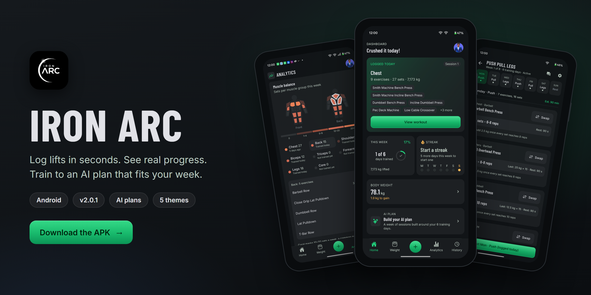

### A strength-training app that remembers every set, knows when you got stronger, and builds your training week with AI.

 

&nbsp;

  

<table>
<tr>
<td width="180" align="center"></td>
<td>

**Scan to install on Android.** The QR code opens the latest APK straight from this repository's releases.

Android 7.0 or newer · free · **no ads, no analytics, no trackers**. Sign in with Google or email; your training lives in your account, so a new phone picks up where the old one left off.

</td>
</tr>
</table>

---

## ⚡ By the numbers

| 🧪 **311** | 🧱 **27,000+** | 📱 **16** | 🎨 **5** | 🏅 **28** | 🔇 **0** |
|:---:|:---:|:---:|:---:|:---:|:---:|
| automated tests 169 app · 142 server | lines of TypeScript in 220 files | screens | themes, switched live | achievement badges | log lines in a release build |

---

## 📱 A quick tour

| 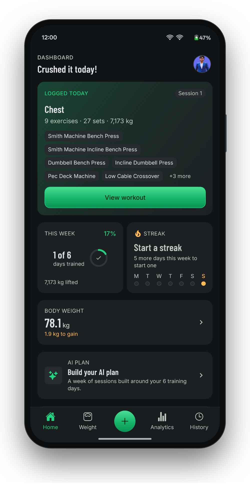 | 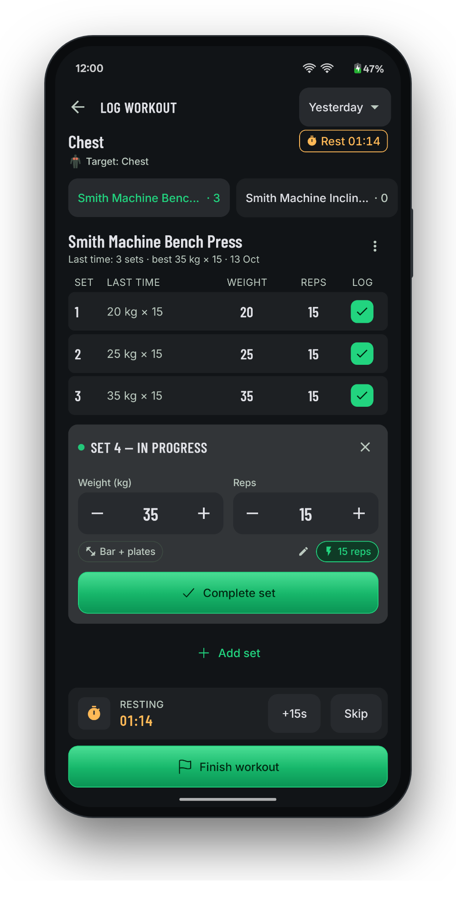 | 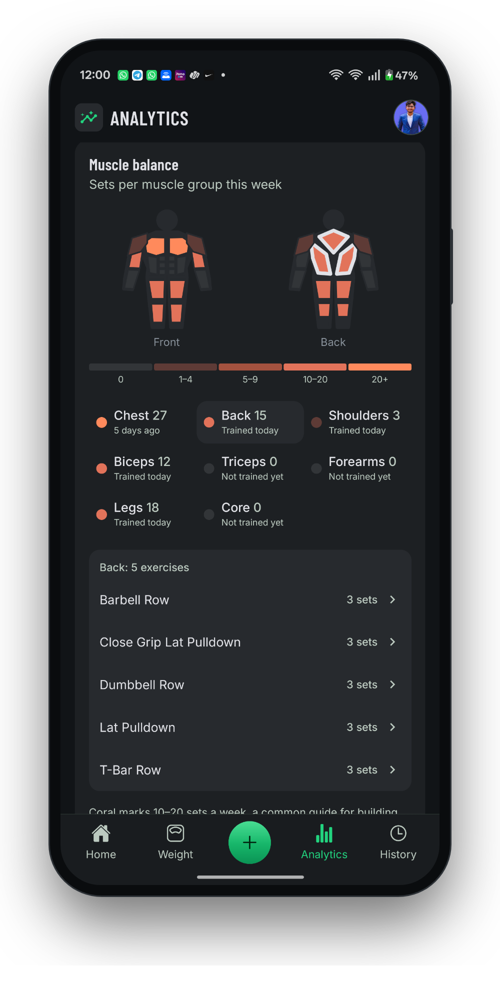 |
|:---:|:---:|:---:|
| **Home** today's session, weekly goal ring, streak and a headline that cheers you on | **Logging a set** last time's weight and reps prefilled; one tap per set | **Analytics** a body map shaded by weekly sets per muscle, records and trends |
| 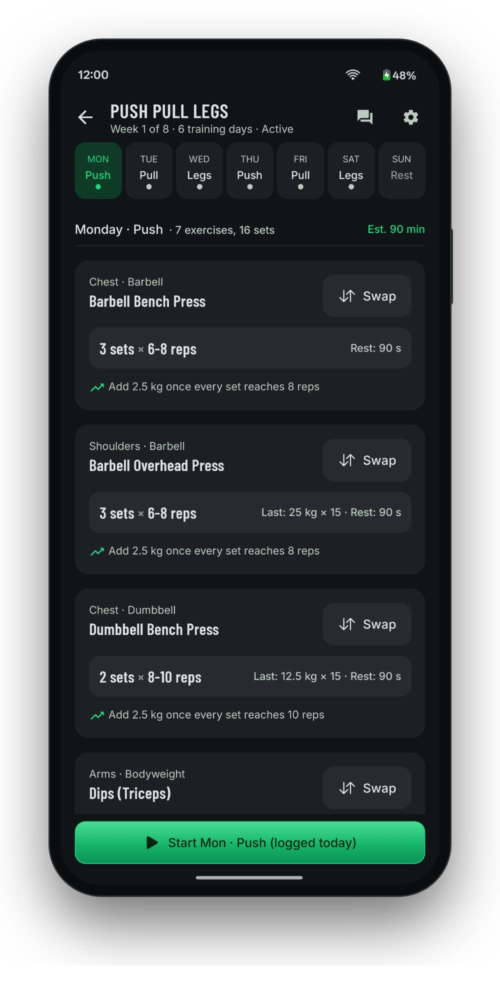 | 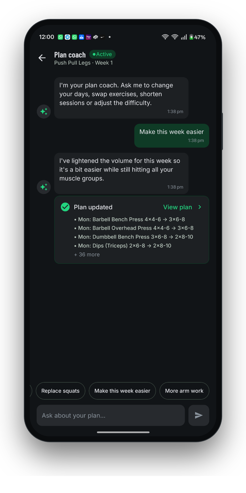 | 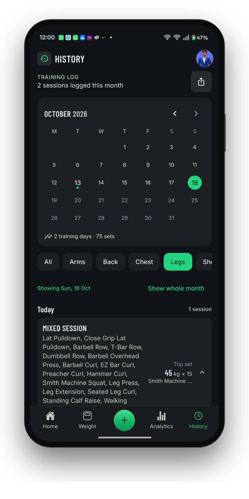 |
| **AI plan** a week built from your days, equipment and experience | **Plan coach** "make it 3 days", "my shoulder hurts": the plan adjusts | **History** a calendar of every session; move one to another day in a tap |
| 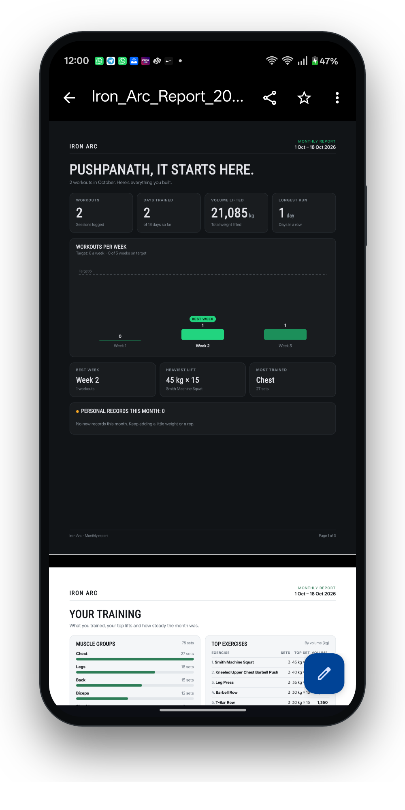 | 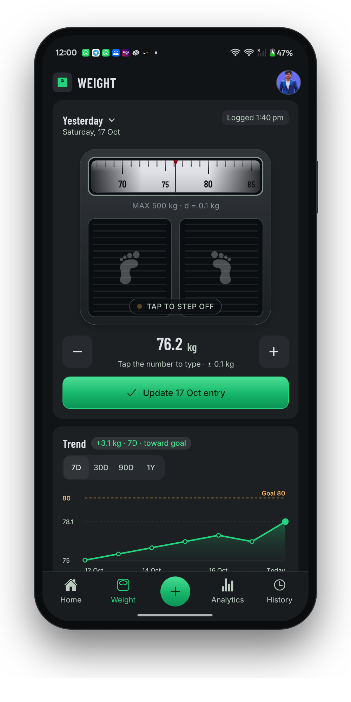 | 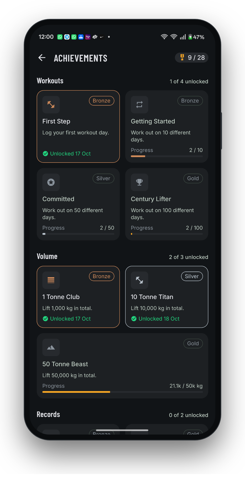 |
| **Monthly report** a 3-page PDF and a 4-sheet Excel file, made on the phone | **Body weight** trend, goal and a weekly weigh-in reminder | **Achievements** 28 badges for consistency, volume, records and variety |

---

## 🎨 One app, five looks

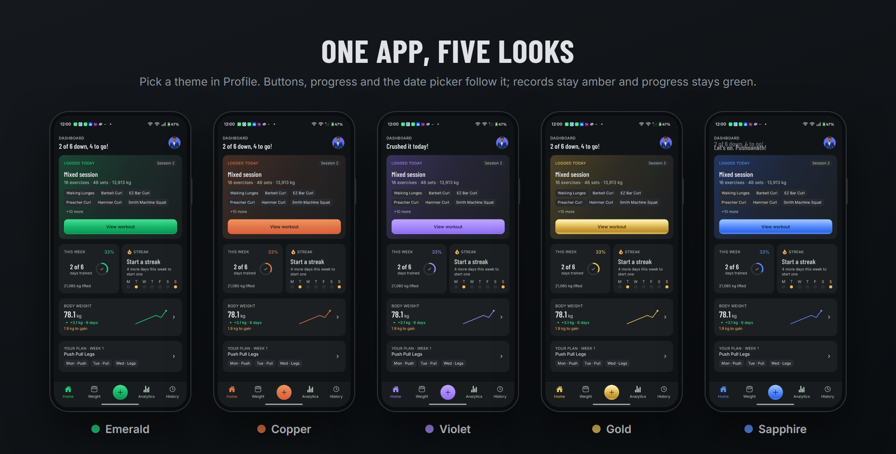

Themes aren't a colour swap. Each one changes the **accent family** (buttons, progress, the tab bar, the date picker) and its own **glossy gradient**, while colours that *mean* something never move: records stay amber, better/worse stays green/red. Every theme had to pass a rule before it shipped: its accent can't pass for a meaning colour. The first gold was rejected for sitting **2–4° of hue** away from the records amber; the shipped Gold is a paler, metallic yellow-gold.

---

## 🆕 What's new in 2.0.1

- **Move a whole session to another day.** Logged on the wrong day? History → open the session → **Change date**. All of it moves in one database transaction, so it can never end up half on one day and half on another.
- **A date picker that follows your theme.** Android's own date dialog can't change colour at runtime, so the app now uses its own calendar: theme-coloured, with dots on the days you trained (or weighed in).

See the [changelog](CHANGELOG.md) for 2.0.0, the big one: themes, the monthly report, calendar plan weeks and more.

---

## 🧠 Engineering stories

The parts that were hard, and how they were solved. Each opens up.

<b>🏆 Every screen agrees on what a "record" is</b>

 

**Problem.** Records show up in five places: the banner while you lift, History, Analytics, the exercise page and the server's badges. Five implementations would eventually disagree.

**Idea.** One rule, written once per side and tested on both: a set is a record if it beats the heaviest earlier weight at the same or more reps, *or* beats every earlier estimated one-rep max (Epley).

**Result.** The app and the server can't contradict each other, and backdated sessions are judged against your history *as it stood on that day*.

<b>💾 A workout is saved completely, or not at all</b>

 

**Problem.** A gym's signal is bad. A session of 9 exercises sent as 9 requests can half-save, and a retry can save it twice.

**Idea.** The session lives in a local draft saved as you go (closing the app loses nothing). Finishing sends it as **one batch** that the server writes in **one transaction**, with a duplicate guard. Moving a session to another day works the same way.

**Result.** No half sessions and no duplicates, even on a flaky connection. Deletes get a real undo: the server call is held for a short window and cancelled if you tap Undo.

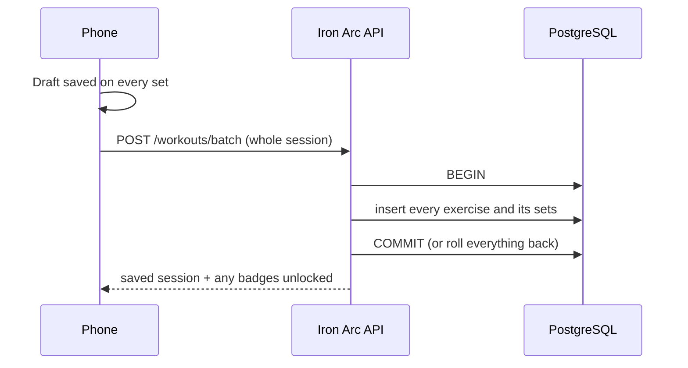

<b>🤖 Making an AI coach fit a free-tier budget</b>

 

**Problem.** The model provider allows a few thousand tokens a minute. A multi-week plan in every coach message blew straight through it.

**Idea.** Send the coach one compact week, plus a short summary of *this* week and *last* week computed on the server. The AI returns **only the days it changed**; the server validates every exercise against a catalogue, keeps your training days fixed, and applies the patch.

**Result.** The prompt went from about **20,600 to 1,300 tokens (94% smaller)**, and a malformed AI reply can never corrupt a plan.

<b>📊 A spreadsheet writer, written from scratch</b>

 

**Problem.** The monthly report needed a real Excel file: styled cards, a frozen header, filters, data bars, totals that follow the filter, and a native bar chart. Spreadsheet libraries either can't do charts or are too heavy for a phone.

**Idea.** An `.xlsx` is a zip of XML files, so the app writes that XML itself: styles, merged cells, `SUBTOTAL` formulas with cached values, conditional data bars and a DrawingML bar-and-line chart. A 30 KB zip library packs it.

**Result.** A 4-sheet workbook and a 3-page PDF (with inline SVG charts) are built **entirely on the phone, offline**. Tests unzip the workbook and check its parts, and it was opened in a spreadsheet reader to confirm the chart, filters and dates.

<b>📅 Plans that follow the real calendar</b>

 

**Problem.** "Week 2" of a plan drifted away from real weeks, and "done" ticks counted sessions from the wrong week.

**Idea.** Every plan week knows its Monday. A day is done only when one of its exercises was logged **on that day's date**, and the next week unlocks the Monday after, written by the coach from everything you actually did.

**Result.** Plan weeks line up with the calendar, ticks are always true, and the coach knows which day it is.

<b>🔒 Release builds that give nothing away</b>

 

**Problem.** An APK can be unpacked, and console logs end up in Android's system log.

**Idea.** A small custom Babel plugin deletes every `console` call, message text included, at compile time for release builds. Developer tools sit behind `__DEV__` branches that the bundler removes entirely. Release builds are minified and resource-shrunk.

**Result.** Zero log lines, no developer screens and no debug strings in the shipped app.

---

## 🏗 Architecture

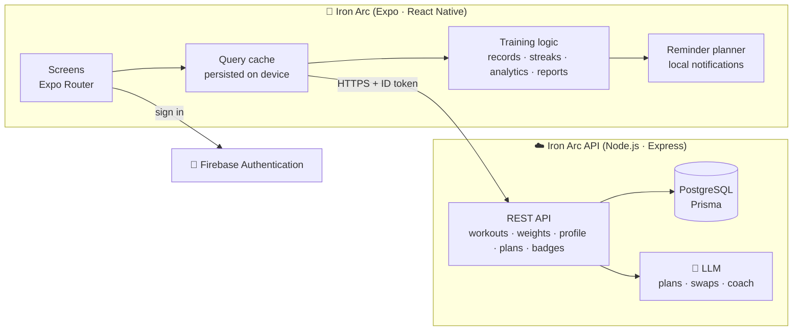

- **The server is the source of truth**; the phone keeps a persisted cache, so screens open instantly and stay readable offline.
- **Training logic runs on the device** from that cache, so every screen shows the same numbers. Badges are checked on the server with the same rules.
- **Reminders are planned, not fired blindly:** a pure planner schedules the next 14 days (at most one nudge a day) and re-plans whenever you log or change a setting, so it never nags about a workout you already did.

---

## 🧰 Built with

| | |
|---|---|
| **App** | Expo SDK 54 · React Native 0.81 (New Architecture) · React 19 · TypeScript (strict) · Expo Router |
| **Data** | TanStack Query v5 with a device-persisted cache |
| **Motion and graphics** | Reanimated 4 · react-native-svg · linear gradients |
| **Server** | Node.js · Express 5 · Prisma · PostgreSQL · Zod validation |
| **AI** | A hosted LLM for plan generation, weekly recalibration, swaps and the coach |
| **Auth** | Firebase Authentication (Google and email) |
| **Quality** | Jest and Node's test runner: 311 tests across app and server |

---

## 🗺 Roadmap

- [x] Fast logging with records, rest timer and plate calculator
- [x] AI plans with weekly recalibration and a plan coach
- [x] Analytics with a muscle body map
- [x] Five themes and a theme-aware date picker
- [x] Monthly PDF and Excel reports
- [x] Move a session to another day
- [ ] Reminders that name the day's planned session
- [ ] A much larger AI exercise catalogue (flies, crossovers, machine work)
- [ ] Coach v2: an AI coach with memory of your training and trends
- [ ] Iron Arc Pro

---

## 📦 Installing the APK

1. On your Android phone, scan the QR code above or tap **Download APK for Android**.
2. Open the downloaded file. If Android asks, allow your browser to install apps.
3. Sign in with Google or email, answer a few questions about your training, and log your first set.

Updates: download the newest release and install it over the old one. Your data stays in your account.

---

 

**Designed, built, debugged, broke, fixed, and shipped by [Pushpanath](https://github.com/pushpanathDev) — the one and only.** 🫡

Product? Me. Design? Me. Mobile app? Me. Backend? Also me. AI? Me again. QA? Unfortunately, also me.

This repository contains releases, screenshots, and engineering notes. The source code stays private — some secrets are best kept secret. 😉

© 2026 Pushpanath. All rights reserved. No co-founders were harmed in the making of this project.

