

<a href="https://pushpanathdev.github.io/Iron_Arc-app/">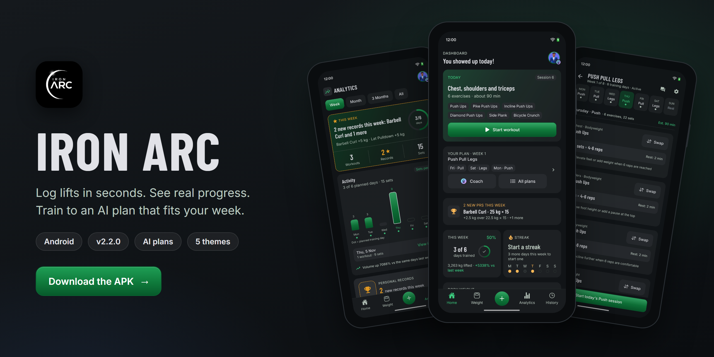</a>

### A strength-training app that remembers every set, knows when you got stronger, and builds your training week with AI.

 

Tap the card to download, or scan its code with your phone · Android 7.0 or newer · free · <b>no ads, no analytics, no trackers</b>

  

Sign in with Google or email. Your training lives in your account, so a new phone picks up where the old one left off.

---

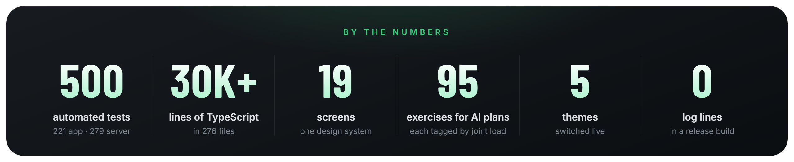

---

## 📱 A quick tour

| 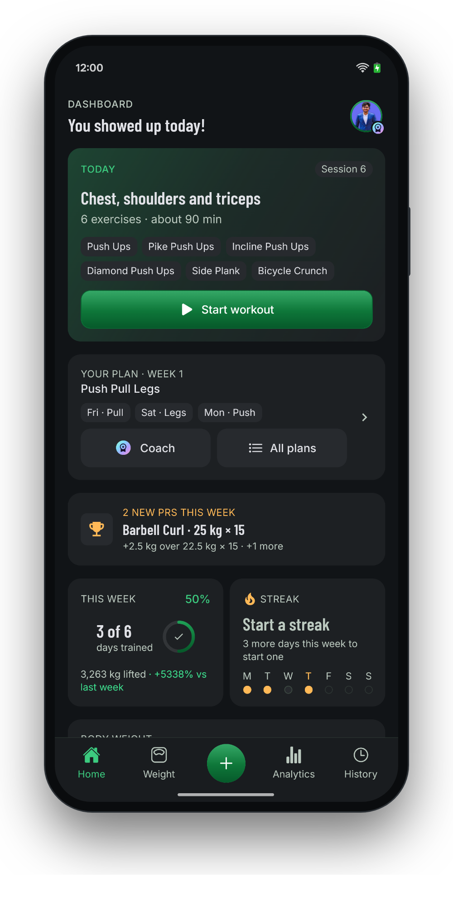 | 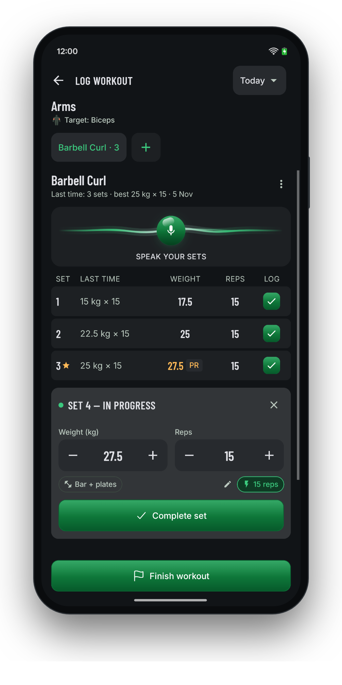 | 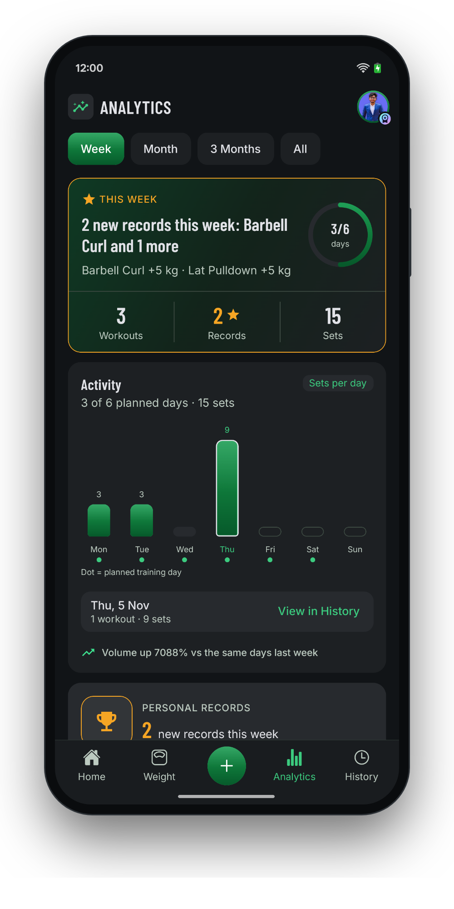 |
|:---:|:---:|:---:|
| **Home** today's session, weekly goal ring, streak and a headline that cheers you on | **Logging a set** last time's weight and reps prefilled; one tap per set | **Analytics** a body map shaded by weekly sets per muscle, records and trends |
| 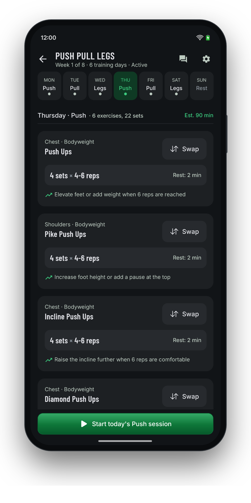 | 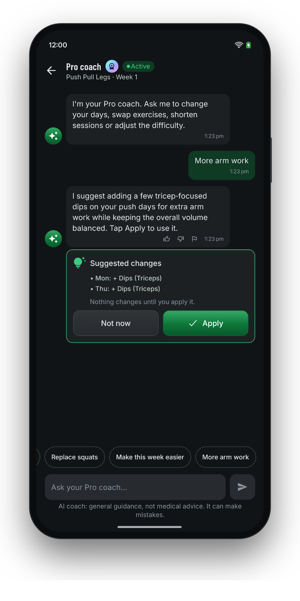 | 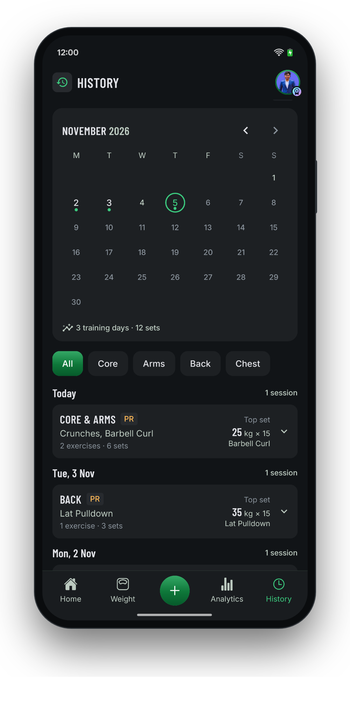 |
| **AI plan** a week built from your days, equipment and experience | **Plan coach** "make it 3 days", "my shoulder hurts": the plan adjusts | **History** a calendar of every session; move one to another day in a tap |
| 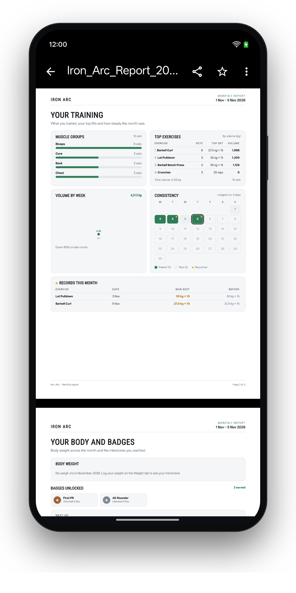 | 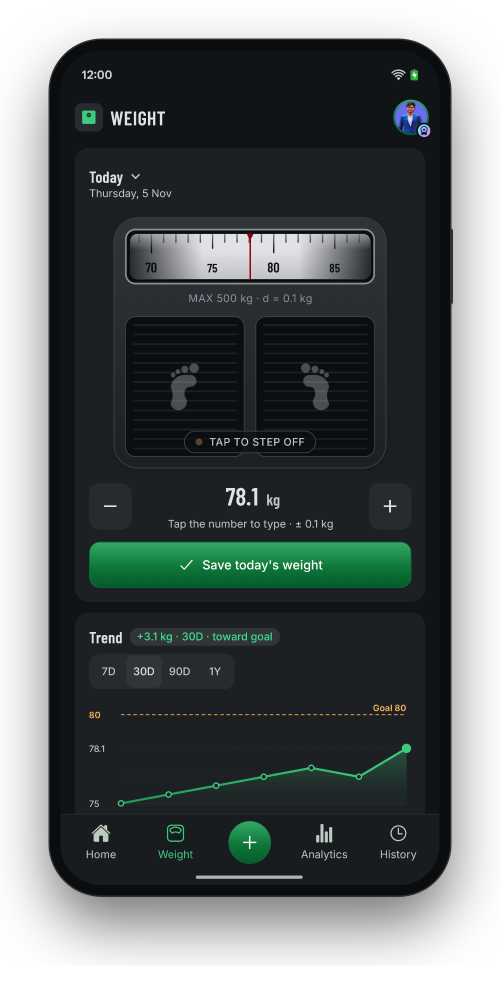 | 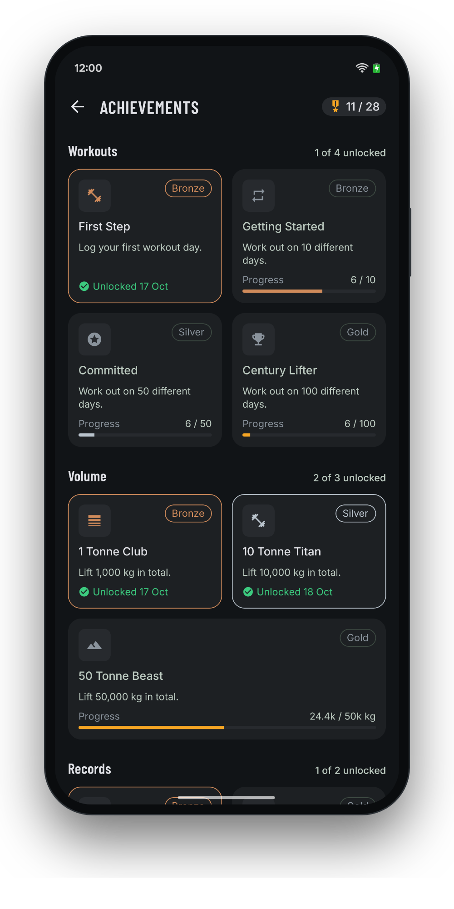 |
| **Monthly report** a 3-page PDF and a 4-sheet Excel file, made on the phone | **Body weight** trend, goal and a weekly weigh-in reminder | **Achievements** 28 badges for consistency, volume, records and variety |

---

## 🎨 One app, five looks

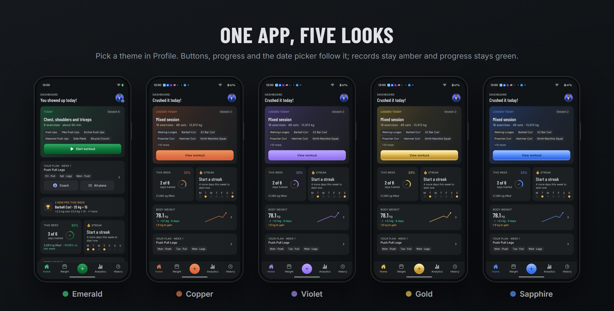

Themes aren't a colour swap. Each one changes the **accent family** (buttons, progress, the tab bar, the date picker) and its own **glossy gradient**, while colours that *mean* something never move: records stay amber, better/worse stays green/red. Every theme had to pass a rule before it shipped: its accent can't pass for a meaning colour. The first gold was rejected for sitting **2–4° of hue** away from the records amber; the shipped Gold is a paler, metallic yellow-gold.

---

## 🆕 What's new in 2.2.0

- **Speak your sets.** Tap the mic and say every set at once, like "first set 60 kilos 10 reps, second set 70 for 8", and they're logged in order. Part of Iron Arc Pro.
- **Speak your notes.** The mic in the note field writes what you say. Recordings are turned into text, then deleted.
- **What's new, in the app.** After each update, a quick look at what changed; Profile → App updates also shows what's coming next.
- **A deeper Emerald**, side-by-side choices in pop-ups, and one calm red for every delete.

See the [changelog](CHANGELOG.md) for everything, and for 2.1.0, 2.0.1 and 2.0.0.

---

## 🧠 Engineering stories

The parts that were hard, and how they were solved. Each opens up.

<b>🏆 Every screen agrees on what a "record" is</b>

 

**Problem.** Records show up in five places: the banner while you lift, History, Analytics, the exercise page and the server's badges. Five implementations would eventually disagree.

**Idea.** One rule, written once per side and tested on both: a set is a record if it beats the heaviest earlier weight at the same or more reps, *or* beats every earlier estimated one-rep max (Epley).

**Result.** The app and the server can't contradict each other, and backdated sessions are judged against your history *as it stood on that day*.

<b>💾 A workout is saved completely, or not at all</b>

 

**Problem.** A gym's signal is bad. A session of 9 exercises sent as 9 requests can half-save, and a retry can save it twice.

**Idea.** The session lives in a local draft saved as you go (closing the app loses nothing). Finishing sends it as **one batch** that the server writes in **one transaction**, with a duplicate guard. Moving a session to another day works the same way.

**Result.** No half sessions and no duplicates, even on a flaky connection. Deletes get a real undo: the server call is held for a short window and cancelled if you tap Undo.

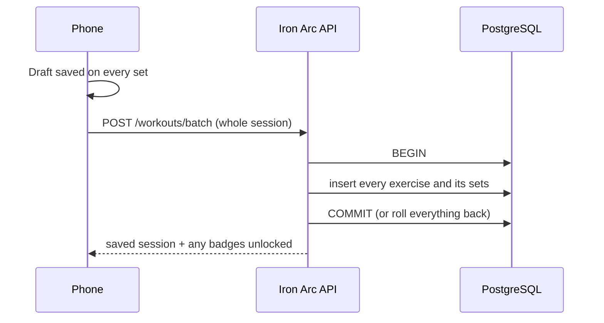

<b>🤖 Making an AI coach fit a free-tier budget</b>

 

**Problem.** The model provider allows a few thousand tokens a minute. A multi-week plan in every coach message blew straight through it.

**Idea.** Send the coach one compact week, plus a short summary of *this* week and *last* week computed on the server. The AI returns **only the days it changed**; the server validates every exercise against a catalogue, keeps your training days fixed, and applies the patch.

**Result.** The prompt went from about **20,600 to 1,300 tokens (94% smaller)**, and a malformed AI reply can never corrupt a plan.

<b>📊 A spreadsheet writer, written from scratch</b>

 

**Problem.** The monthly report needed a real Excel file: styled cards, a frozen header, filters, data bars, totals that follow the filter, and a native bar chart. Spreadsheet libraries either can't do charts or are too heavy for a phone.

**Idea.** An `.xlsx` is a zip of XML files, so the app writes that XML itself: styles, merged cells, `SUBTOTAL` formulas with cached values, conditional data bars and a DrawingML bar-and-line chart. A 30 KB zip library packs it.

**Result.** A 4-sheet workbook and a 3-page PDF (with inline SVG charts) are built **entirely on the phone, offline**. Tests unzip the workbook and check its parts, and it was opened in a spreadsheet reader to confirm the chart, filters and dates.

<b>📅 Plans that follow the real calendar</b>

 

**Problem.** "Week 2" of a plan drifted away from real weeks, and "done" ticks counted sessions from the wrong week.

**Idea.** Every plan week knows its Monday. A day is done only when one of its exercises was logged **on that day's date**, and the next week unlocks the Monday after, written by the coach from everything you actually did.

**Result.** Plan weeks line up with the calendar, ticks are always true, and the coach knows which day it is.

<b>🔒 Release builds that give nothing away</b>

 

**Problem.** An APK can be unpacked, and console logs end up in Android's system log.

**Idea.** A small custom Babel plugin deletes every `console` call, message text included, at compile time for release builds. Developer tools sit behind `__DEV__` branches that the bundler removes entirely. Release builds are minified and resource-shrunk.

**Result.** Zero log lines, no developer screens and no debug strings in the shipped app.

---

## 🏗 Architecture

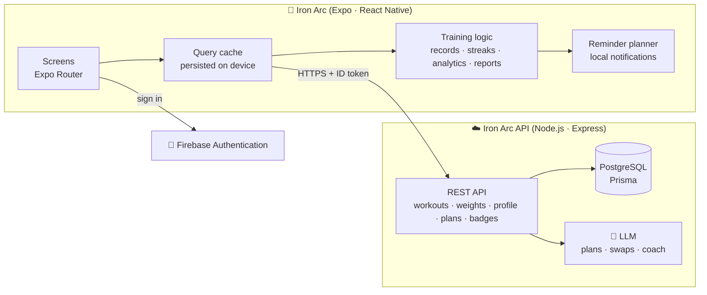

- **The server is the source of truth**; the phone keeps a persisted cache, so screens open instantly and stay readable offline.
- **Training logic runs on the device** from that cache, so every screen shows the same numbers. Badges are checked on the server with the same rules.
- **Reminders are planned, not fired blindly:** a pure planner schedules the next 14 days (at most one nudge a day) and re-plans whenever you log or change a setting, so it never nags about a workout you already did.

---

## 🧰 Built with

| | |
|---|---|
| **App** | Expo SDK 54 · React Native 0.81 (New Architecture) · React 19 · TypeScript (strict) · Expo Router |
| **Data** | TanStack Query v5 with a device-persisted cache |
| **Motion and graphics** | Reanimated 4 · react-native-svg · linear gradients |
| **Server** | Node.js · Express 5 · Prisma · PostgreSQL · Zod validation |
| **AI** | A hosted LLM for plan generation, weekly recalibration, swaps and the coach |
| **Auth** | Firebase Authentication (Google and email) |
| **Quality** | Jest and Node's test runner: 500 tests across app and server |

---

## 🗺 Roadmap

| Status | Feature |
|:--|:--|
|  | **A super-powered coach:** a big upgrade to today's coach, with memory of your training and trends |
|  | **Sharper voice logging:** better with fast speech and more gym words |
|  | Speak your sets and notes (Pro): say every set at once and they're logged |
|  | What's new and Coming next, inside the app |
|  | Iron Arc Pro (payments in test mode) |
|  | Health check, Safe mode and "go easy on" joints |
|  | A much larger AI exercise catalogue: flies, crossovers, machine work |
|  | Reminders that name the day's planned session |
|  | Updates announced inside the app |
|  | Move a session to another day |
|  | A theme-aware date picker |
|  | AI plans with weekly recalibration and a plan coach |
|  | Analytics with a muscle body map |
|  | Five themes |
|  | Monthly PDF and Excel reports |
|  | Fast logging with records, rest timer and plate calculator |

---

## 📦 Installing the APK

1. On your Android phone, tap **Download APK** in the card at the top (on a computer, scan its QR code), then **Download** on the page that opens. Every APK carries its version in its name (`Iron-Arc-2.1.0.apk`), so older downloads are easy to tell apart.
2. Open the downloaded file. If Android asks, allow your browser to install apps.
3. Sign in with Google or email, answer a few questions about your training, and log your first set.

Updates: from 2.1.0 the app tells you when a new version is out and links to it; install it over the old one. Your data stays in your account.

What Iron Arc keeps and why: the [privacy policy](https://pushpanathdev.github.io/Iron_Arc-app/privacy.html).

---

 

**Designed, built, debugged, broke, fixed, and shipped by [Pushpanath](https://github.com/pushpanathDev) — the one and only.** 🫡

Product? Me. Design? Me. Mobile app? Me. Backend? Also me. AI? Me again. QA? Unfortunately, also me.

This repository contains releases, screenshots, and engineering notes. The source code stays private — some secrets are best kept secret. 😉

© 2026 Pushpanath. All rights reserved. No co-founders were harmed in the making of this project.

